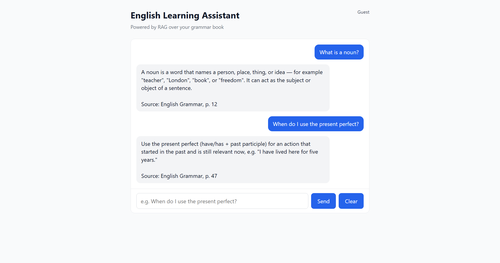

# English Learning RAG System

An AI-powered English learning assistant. Ask questions about an English grammar
book and get answers with page references, generated from the book's own content
via Retrieval-Augmented Generation.



## Tech Stack

| Layer            | Technology                        |
| ---------------- | --------------------------------- |
| Frontend         | React.js + Vite                   |
| Backend API      | ASP.NET Core Web API (.NET 10)    |
| RAG service      | Python + FastAPI                  |
| LLM              | Google Gemini API                 |
| Vector database  | Qdrant                            |
| Relational DB    | Supabase PostgreSQL (optional)    |

## Architecture

```text
React  ->  ASP.NET Core  ->  Python FastAPI RAG  ->  Qdrant   (vector search)
                                                 ->  Gemini   (answer generation)

ASP.NET Core  ->  Supabase PostgreSQL  (users / conversations / messages / books)
```

- **Qdrant** stores only vector-search data: embeddings, book chunks, page
  numbers, and source metadata.
- **Supabase PostgreSQL** stores relational application data: users,
  conversations, messages, books, chapters.

## Project Structure

```text
english-learning-rag/
├── frontend/     # React + Vite chat UI
├── backend/      # ASP.NET Core Web API (talks to React + RAG + Supabase)
├── rag/          # Python FastAPI: PDF -> chunks -> embeddings -> Qdrant + Gemini
├── supabase/     # DB migrations + migrate script (Supabase CLI)
├── .gitignore
└── README.md
```

##  Rag Development Orde

1. PDF
   ↓
2. Text Extraction
   ↓
3. Text Cleaning
   ↓
4. Chunking
   ↓
5. Embedding
   ↓
6. Qdrant-এ Store
   ↓
7. User Question
   ↓
8. Query Embedding
   ↓
9. Relevant Chunks Retrieve
   ↓
10. Gemini
   ↓
11. Answer + Source

## Setup

Copy every `.env.example` to `.env` and fill in the blanks. **Never commit `.env`
files.**

### 1. Qdrant (vector store)

By default the RAG service runs Qdrant **embedded** (a local folder, no server or
Docker). Nothing to start. `rag/.env` controls this:

```env
QDRANT_URL=local          # embedded, stored in rag/qdrant_storage/
# QDRANT_URL=http://localhost:6333   # to use a real Qdrant server instead
```

Embedded mode allows only one process at a time — run `ingest.py` first, then the
API. For a standalone server: `docker run -p 6333:6333 qdrant/qdrant`.

### 2. RAG service (Python + FastAPI)

> Use **Python 3.11 or 3.12**. Python 3.14 has no prebuilt wheels for some
> dependencies on Windows and will try (and fail) to compile them.

```bash
cd rag
py -3.11 -m venv .venv              # or: python3.11 -m venv .venv
.venv\Scripts\activate            # Windows  (source .venv/bin/activate on macOS/Linux)
python -m pip install -U pip
pip install -r requirements.txt
cp .env.example .env               # then set GEMINI_API_KEY
python ingest.py                   # load data/english-book.pdf into Qdrant
uvicorn main:app --reload --port 8000
```

### 3. Backend (ASP.NET Core)

```bash
cd backend
cp .env.example .env               # set RAG_SERVICE_URL and (optionally) Supabase keys
dotnet run
```

API runs on `http://localhost:5000` (`POST /api/chat`, `GET /api/health`).

### 4. Frontend (React + Vite)

```bash
cd frontend
npm install
cp .env.example .env               # set VITE_API_URL + Supabase vars
npm run dev
```

Open the URL Vite prints (default `http://localhost:5173`).

### 5. Supabase + login

Supabase powers both auth (login/logout) and chat history.

1. Create a Supabase project.
2. **Project Settings → API** → copy the **Project URL**
   (`https://<ref>.supabase.co`, *not* the dashboard URL) and the **anon** key.
3. Put them where they belong:
   - `backend/.env` → `SUPABASE_URL`, `SUPABASE_ANON_KEY`, `SUPABASE_SERVICE_ROLE_KEY`
   - `frontend/.env` → `VITE_SUPABASE_URL`, `VITE_SUPABASE_ANON_KEY`

   The **service_role** key (Settings → API → "service_role", Reveal) is a
   backend-only secret — never put it in the frontend.
4. Run the database migrations (see next section).

### Database migrations

Schema lives in [`supabase/migrations/`](supabase/migrations/) and is applied with
the Supabase CLI (`npx supabase`, no install needed).

**One-time setup:**

```bash
cp supabase/.env.example supabase/.env
```

Then edit `supabase/.env` and set `SUPABASE_DB_URL` — get it from the Supabase
dashboard **Connect** button ("Session pooler" or "Direct connection"), replacing
`[YOUR-PASSWORD]` with your DB password.

**Apply migrations (run this whenever you add a new file to `supabase/migrations/`):**

```powershell
./supabase/migrate.ps1        # Windows
```

```bash
./supabase/migrate.sh         # macOS / Linux
```

The CLI records applied migrations in `supabase_migrations.schema_migrations`, so
re-running only applies what's new — the DB stays in sync with the repo.

**Add a migration:** create `supabase/migrations/<timestamp>_name.sql` (e.g.
`20260901090000_add_progress_table.sql`) and run the migrate script again.

### How auth works

- **Sign up** goes to the backend `POST /api/auth/register`, which creates an
  already-confirmed user via the Supabase admin API. **No confirmation email is
  sent**, so it never hits Supabase's email rate limit. The React app then signs in.
- **Sign in / out** use `@supabase/supabase-js` directly; the app holds the session.
- Each `POST /api/chat` sends the Supabase access token as
  `Authorization: Bearer <token>`. The backend validates it via
  `GET /auth/v1/user`, then writes the conversation and messages with that same
  token, so row-level security keeps every user to their own rows.
- If Supabase env vars are blank, `/api/chat` returns 401 (auth is required).
- Without `SUPABASE_SERVICE_ROLE_KEY`, sign-up is disabled (sign-in still works) —
  create users from the Supabase dashboard instead.

## Environment Variables

`frontend/.env`

```env
VITE_API_URL=http://localhost:5000
VITE_SUPABASE_URL=
VITE_SUPABASE_ANON_KEY=
```

`backend/.env`

```env
RAG_SERVICE_URL=http://localhost:8000
FRONTEND_URL=http://localhost:5173
SUPABASE_URL=
SUPABASE_ANON_KEY=
SUPABASE_SERVICE_ROLE_KEY=
```

`rag/.env`

```env
GEMINI_API_KEY=
GEMINI_MODEL=gemini-1.5-flash
GEMINI_EMBED_MODEL=text-embedding-004
QDRANT_URL=http://localhost:6333
QDRANT_API_KEY=
QDRANT_COLLECTION=english_book
TOP_K=5
BOOK_PATH=data/english-book.pdf
```
