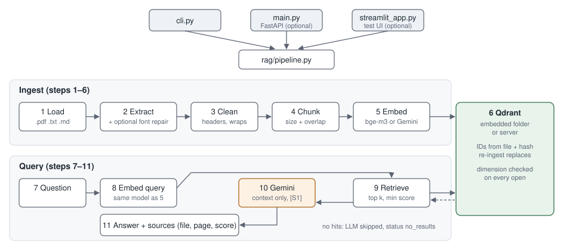

# RAG Toolkit

A small, readable Retrieval-Augmented Generation toolkit for developers. Index
PDF, text and Markdown files into Qdrant, then ask questions and get answers
that cite the chunks (and PDF page numbers) they came from.

Every pipeline step is its own module under [`rag/`](rag/), so you can read,
test and swap each one. Use it from the command line, from Python, through an
optional FastAPI service, or through an optional Streamlit test UI.



> The `frontend/`, `backend/`, `supabase/` and `files/` folders belong to the
> retired web app and are scheduled for removal. Nothing in the toolkit uses them.

## What it does

| Step | Module | Notes |
| ---- | ------ | ----- |
| 1 Load | `step01_load_pdf.py` | `.pdf`, `.txt`, `.md`; validates before any work |
| 2 Extract | `step02_extract_text.py` | one Document per PDF page; optional font repair |
| 3 Clean | `step03_clean_text.py` | unwrap lines, join hyphenation, drop headers/footers |
| 4 Chunk | `step04_chunking.py` | recursive splitter, overlap, `chunk_id` per document |
| 5 Embed | `step05_embedding.py` | local Hugging Face model (default `BAAI/bge-m3`) or Gemini |
| 6 Store | `step06_vector_store.py` | Qdrant, embedded on disk or a server |
| 7–9 Retrieve | `step07`…`step09` | cosine search, optional minimum score |
| 10 Generate | `step10_generate.py` | Gemini, context-only, tags claims `[S1]`, `[S2]`… |
| 11 Answer | `step11_answer.py` | answer plus the sources behind each marker |

[`rag/pipeline.py`](rag/pipeline.py) wires the steps together; the CLI, API and
UI all use it. See [docs/pipeline.md](docs/pipeline.md) for per-step notes.

## Prerequisites

- **Python 3.11 or 3.12.** Verified on 3.11.9. Python 3.13+ is not a supported
  baseline yet (some dependencies lack prebuilt Windows wheels).
- A **Gemini API key** for answer generation
  ([get one](https://aistudio.google.com/app/apikey)). Retrieval and ingestion
  with the default local embeddings need no key.
- Disk space for the embedding model: `BAAI/bge-m3` is about 2.2 GB and is
  downloaded to the Hugging Face cache on first use.
- Optional: Docker, if you prefer a Qdrant server to the embedded store.

## Install

```bash
py -3.11 -m venv .venv            # macOS/Linux: python3.11 -m venv .venv
.venv\Scripts\activate            # macOS/Linux: source .venv/bin/activate
python -m pip install -U pip
pip install -r requirements.txt   # core pipeline + CLI

# optional extras
pip install -r requirements-api.txt   # FastAPI service
pip install -r requirements-ui.txt    # Streamlit test UI
pip install -r requirements-dev.txt   # tests (includes the API extra)
```

## Configure

```bash
cp .env.example .env              # then set GOOGLE_API_KEY
python cli.py check               # settings, dependencies, vector store
python cli.py check --deep        # also loads the embedding model, compares dimensions
```

`.env` is always read from the project folder, and relative paths in it
(`QDRANT_PATH`, `PDF_PATH`) are resolved from the project folder too, so
commands behave the same from any working directory.

| Variable | Default | Purpose |
| -------- | ------- | ------- |
| `GOOGLE_API_KEY` | – | Gemini key (generation; embeddings if provider is `google`) |
| `LLM_MODEL` | `gemini-2.5-flash` | Gemini model for answers |
| `TEMPERATURE` | `0.2` | LLM temperature |
| `EMBEDDING_PROVIDER` | `huggingface` | `huggingface` (local) or `google` |
| `EMBEDDING_MODEL` | `BAAI/bge-m3` | 1024-dim; `models/gemini-embedding-001` for `google` |
| `EMBEDDING_DIM` | auto | set only to skip auto-detection |
| `QDRANT_PATH` | – | embedded store folder, e.g. `qdrant_data` (wins over URL) |
| `QDRANT_URL` / `QDRANT_API_KEY` | `http://localhost:6333` | Qdrant server |
| `COLLECTION_NAME` | `pdf_rag` | collection to read and write |
| `PDF_PATH` | `data/sample.pdf` | file for `ingest` with no arguments |
| `PDF_FONT_REPAIR` | `false` | repair scrambled-glyph PDFs (see below) |
| `CHUNK_SIZE` / `CHUNK_OVERLAP` | `1000` / `150` | chunking |
| `TOP_K` | `4` | chunks per question |
| `MIN_SCORE` | – | drop chunks below this cosine score |
| `EMBED_BATCH_SIZE` / `EMBED_SLEEP` | `90` / `0` (`60` for google) | ingestion batching |

A collection is tied to the embedding model that built it. If the model's
dimension does not match the collection, every command stops with an error
instead of writing incompatible vectors.

## Ingest documents

```bash
python cli.py ingest data/book.pdf notes.md      # several files at once
python cli.py ingest                             # PDF_PATH from .env
python cli.py ingest report.pdf --collection experiments
python cli.py ingest scanned-font.pdf --font-repair on
```

- **Re-ingesting replaces.** Chunks get IDs derived from file name, content
  hash and position. Ingesting a file again overwrites its chunks and removes
  any older ones with the same file name, so nothing is duplicated. Two
  different files with the same name in one collection count as one document.
- **Delete one document:** `python cli.py delete report.pdf` (asks first; `-y` to skip).
- **List documents:** `python cli.py documents`.
- **Start over:** `python cli.py ingest file.pdf --recreate` drops the whole
  collection first. Needed after changing the embedding model.

`python ingest.py …` still works as a shortcut (including the old `--pdf` flag).

## Ask questions

```bash
python cli.py ask "What is a countable noun?"
python cli.py ask                                  # interactive, 'exit' to quit
python cli.py ask "..." --show-chunks              # also print each chunk in full
python cli.py ask "..." --json                     # machine-readable
```

The answer is printed with its `[S1]`… markers followed by the sources, each
with file, page (PDFs only) and similarity score. If nothing is retrieved (or
nothing passes `--min-score`), the LLM is not called and the status is
`no_results`. `python ask.py "…"` remains as a shortcut.

## Inspect retrieval

```bash
python cli.py search "What is a countable noun?" -k 8          # no LLM call
python cli.py search "..." --full                               # whole chunk text
python cli.py search "..." --json                               # scores + metadata
```

Each hit shows score, file, page, `chunk_id` and `doc_id`. With `--json`, step
progress goes to stderr and stdout holds only the JSON.

## Optional FastAPI service

```bash
pip install -r requirements-api.txt
python cli.py serve --port 8000            # or: uvicorn main:app --port 8000
```

- `GET /health` → `{"status": "ok", "ready": true}`
- `POST /query` with `{"question": "...", "top_k": 4}` →
  `{"answer": "...", "status": "answered" | "no_results", "sources": [{"page", "source", "score", "marker", "chunk_id", "text"}]}`

`answer` has the markers stripped; `marker` on each source maps them back.
Pipeline failures return 503 with the reason.

## Optional Streamlit test UI

```bash
pip install -r requirements-ui.txt
python cli.py ui                           # http://localhost:8501
```

Upload and ingest documents, ask questions or run retrieval only, and inspect
scores, pages, chunk text and metadata. Uploads are saved under `uploads/`
(git-ignored). It is a testing tool, not a production front end.

## Use from Python

```python
from rag.pipeline import Pipeline

pipeline = Pipeline(collection="pdf_rag")
pipeline.ingest("data/book.pdf")
result = pipeline.ask("What is a noun?")
print(result.status, result.answer_without_markers)
for source in result.sources:
    print(source["marker"], source["file"], source["page"], source["score"])
pipeline.close()
```

## Supported inputs and providers

- **Files:** `.pdf` (text layer required), `.txt` and `.md` (UTF-8).
- **Embeddings:** any sentence-transformers model through Hugging Face, or
  Gemini embeddings.
- **LLM:** Gemini via `langchain-google-genai`.
- **Vector store:** Qdrant, embedded (`QDRANT_PATH`) or server (`QDRANT_URL`).

### PDF font repair

Some PDFs embed subset fonts without a `ToUnicode` map, and every extractor
returns scrambled glyphs (`& ? ! & &`). [`rag/pdf_font_repair.py`](rag/pdf_font_repair.py)
reverses that substitution for the bundled `-Free-English-Grammar.pdf`. It is
off by default; enable it with `PDF_FONT_REPAIR=true` or `--font-repair on`.
Its maps are specific to that PDF; for other broken PDFs, use OCR instead.

## Tests

```bash
pip install -r requirements-dev.txt
python -m pytest                     # unit tests: no network, no model download, no API calls
```

Integration tests are opt-in. They run the CLI against your real `.env`:

```bash
# PowerShell: $env:RAG_RUN_INTEGRATION = "1"
RAG_RUN_INTEGRATION=1 python -m pytest -m integration
RAG_RUN_INTEGRATION=1 RAG_RUN_GEMINI=1 python -m pytest -m "integration or gemini"   # uses Gemini quota
```

They read `COLLECTION_NAME` without changing it, and ingest only into a
uniquely named collection inside a temporary Qdrant folder. Stop `serve` and
`ui` first.

## Troubleshooting

| Message | Fix |
| ------- | --- |
| `No local Qdrant store at …` | Ingest something first, or point `QDRANT_PATH` at the existing store. |
| `… is in use by another process` | Embedded Qdrant allows one process. Stop `serve`/`ui`/other commands, or use a Qdrant server. |
| `Collection 'x' holds N-dimensional vectors, but … produces M` | The embedding model changed. Restore `EMBEDDING_MODEL`, use another `COLLECTION_NAME`, or `--recreate`. |
| `GOOGLE_API_KEY is not set` | Put the key in `.env` next to `config.py`. |
| `… could not answer … 429` | Gemini rate limit or quota. Wait, or raise `EMBED_SLEEP` when using Gemini embeddings. |
| `… page(s) look corrupted` | Scrambled text: try `--font-repair on`; scanned PDF: run OCR (e.g. `ocrmypdf`). |
| `Unsupported file type` | Convert to PDF, `.txt` or `.md`. |

## Known limitations

- Embedded Qdrant is single-process: run one of CLI / API / UI at a time.
- No OCR: scanned PDFs need to be OCR'd first.
- Documents are identified by file name within a collection.
- Only Gemini is wired up for generation.
- Chunks indexed before the migration lack `doc_id` and `file_type`
  metadata; re-ingest the file to add them.

## License

[MIT](LICENSE)
