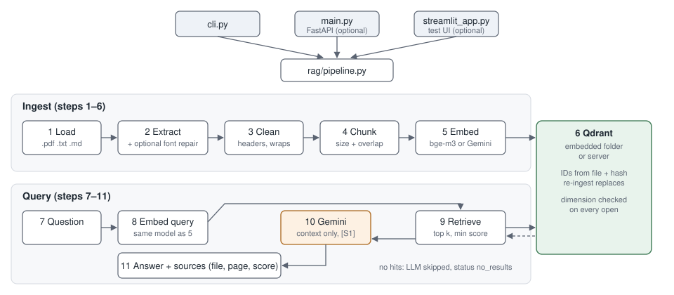

# rag-kit

[](https://pypi.org/project/ragkit-dev/)
[](https://pypi.org/project/ragkit-dev/)
[](https://www.npmjs.com/package/rag-kit-dev)
[](https://github.com/shamiulriyad/rag-learning/actions/workflows/ci.yml)
[](https://github.com/shamiulriyad/rag-learning/blob/main/LICENSE)

**Ask questions about your own PDFs and notes, and get answers that show which
page they came from.**

rag-kit is a small RAG toolkit for Python. You give it documents (PDF, `.txt`
or `.md`). It splits them into chunks and stores them in a vector database
(Qdrant). When you ask a question, it finds the chunks that match best, and
Gemini writes an answer from those chunks only. Each claim in the answer is
tagged `[S1]`, `[S2]`… so you can check it against the source.

> **New to RAG?** RAG (retrieval-augmented generation) means the AI first
> *looks up* the relevant parts of your documents, then *writes* the answer
> from them. It answers from your files instead of from memory, and it tells
> you when your files don't contain the answer.

**Contents:** [Example](#example) · [How it works](#how-it-works) ·
[Quick start](#quick-start) · [Commands](#commands) ·
[Browser UI, Python and API](#browser-ui-python-and-api) ·
[Install with pip](#install-with-pip) · [Settings](#settings) ·
[Troubleshooting](#troubleshooting)

## Example

A 296-page programming book, indexed and then asked a question (output
shortened):

```text
$ rag-kit ingest data/book.pdf
[2] Extracted  : 296 pages, 410,128 characters
[4] Chunked    : 620 chunks (size=1000, overlap=150)
[6] Qdrant     : collection 'pdf_rag' now holds 620 vectors

$ rag-kit ask "What is dynamic programming and when should it be used?"
Dynamic programming is a technique that combines the correctness of complete
search and the efficiency of greedy algorithms [S1]. It can be applied if a
problem can be divided into overlapping subproblems that can be solved
independently [S1].

Sources:
  [S1] book.pdf, page 75   (score 0.731)
  [S2] book.pdf, page 144  (score 0.668)
```

## How it works



There are two phases:

1. **Ingest**, once per document: load the file → extract the text page by
   page → clean it → split it into overlapping chunks → turn each chunk into a
   vector (embedding) → store the vectors in Qdrant.
2. **Ask**, for every question: turn the question into a vector → find the
   closest chunks → Gemini answers from those chunks only → you get the
   answer plus its sources.

Each step is its own short module in
[`src/rag_kit/`](https://github.com/shamiulriyad/rag-learning/tree/main/src/rag_kit),
so you can read, test or replace any one of them.
[`pipeline.py`](https://github.com/shamiulriyad/rag-learning/blob/main/src/rag_kit/pipeline.py)
connects them, and the command line, the browser UI and the API all use it.

<details>
<summary>Where each step lives in the code</summary>

| Step | Module | What it does |
| ---- | ------ | ------------ |
| 1 Load | `step01_load_pdf.py` | accepts `.pdf`, `.txt`, `.md`; checks the file before any work |
| 2 Extract | `step02_extract_text.py` | one document per PDF page; optional font repair |
| 3 Clean | `step03_clean_text.py` | rejoins broken lines and hyphenated words, fixes ligatures like `fi`, drops repeating headers, footers and table-of-contents pages |
| 4 Chunk | `step04_chunking.py` | recursive splitter with overlap; a `chunk_id` per document |
| 5 Embed | `step05_embedding.py` | local Hugging Face model (default `BAAI/bge-m3`) or Gemini |
| 6 Store | `step06_vector_store.py` | Qdrant, either a folder on disk or a server |
| 7 Question | CLI, API or UI | where the question comes from |
| 8–9 Retrieve | `step08_query_embedding.py`, `step09_retrieve.py` | cosine search, optional minimum score |
| 10 Generate | `step10_generate.py` | Gemini answers from the context only and tags claims `[S1]`, `[S2]`… |
| 11 Answer | `step11_answer.py` | the answer plus the source behind each tag |

More detail per step: [docs/pipeline.md](https://github.com/shamiulriyad/rag-learning/blob/main/docs/pipeline.md).

</details>

## Quick start

**You need:** Node.js 20 or newer, Python 3.11 or 3.12, and a free
[Gemini API key](https://aistudio.google.com/app/apikey).

**1. Create a project.** The `rag-kit-dev` generator makes a folder with a
settings template, a `data/` folder and a Python environment with rag-kit
installed.

```bash
npx rag-kit-dev@latest my-rag
```

It asks how to create embeddings:

| Choice | Install size | Indexing cost |
| ------ | ------------ | ------------- |
| **local** (default) | large: PyTorch plus a 2.2 GB model, downloaded on first use | free, works offline |
| **gemini** | small, no PyTorch | uses your Gemini quota |

To skip the question, add `--embeddings gemini` (or `--embeddings local`).
Other options (`--no-install`, `--python`, `--gpu`, …) are in the
[generator README](https://github.com/shamiulriyad/rag-learning/blob/main/generator/README.md).

**2. Add your API key.**

```bash
cd my-rag
Copy-Item .env.example .env          # macOS/Linux: cp .env.example .env
```

Open `.env` and set `GOOGLE_API_KEY=your-key`. Never commit `.env`.

**3. Activate the environment and check the setup.**

```bash
.venv\Scripts\Activate.ps1           # macOS/Linux: source .venv/bin/activate
rag-kit check
```

**4. Add a document and ask.** Copy a PDF into `data/`, then:

```bash
rag-kit ingest data/your-document.pdf
rag-kit ask "your question"
```

With local embeddings, the first ingest downloads the model once. Indexing a
300-page book took about 10 minutes on a laptop CPU.

## Commands

| Command | What it does |
| ------- | ------------ |
| `rag-kit check` | checks settings, installed packages and the vector store (`--deep` also loads the model) |
| `rag-kit ingest FILE …` | adds documents; adding a file again replaces its old chunks |
| `rag-kit ask "question"` | answers with sources; without a question it starts an interactive session |
| `rag-kit search "question"` | shows the matching chunks only, with no AI call |
| `rag-kit documents` | lists the indexed files and their chunk counts |
| `rag-kit delete FILE` | removes one file's chunks (asks first; `-y` skips the question) |
| `rag-kit ui` | opens the browser UI at http://localhost:8501 |
| `rag-kit serve` | starts the HTTP API at http://localhost:8000 |

Every command accepts `--project DIR` and `--collection NAME`.

```bash
rag-kit ingest data/book.pdf notes.md        # several files at once
rag-kit ingest                               # the file named in PDF_PATH
rag-kit ingest report.pdf --collection test  # a separate collection
rag-kit ingest book.pdf --recreate           # empty the collection first
rag-kit ask "..." --show-chunks              # also print each chunk in full
rag-kit ask "..." -k 8 --min-score 0.5       # more chunks, drop weak matches
rag-kit ask "..." --json                     # machine-readable output
rag-kit search "..." --full                  # full chunk text, no AI call
rag-kit documents --json
```

**Tip: ask specific questions.** Each answer is built from only the top few
chunks (`TOP_K`, 4 by default). "What is a segment tree?" works well. "Summarize
chapter 1" doesn't, because a whole chapter is spread over dozens of chunks.

<details>
<summary>More about ingesting</summary>

- **Adding a file again replaces it.** Chunk IDs come from the file name,
  content and position, so ingesting a file again overwrites its chunks and
  removes older ones with the same name. Nothing is duplicated. Two different
  files with the same name in one collection count as one document.
- **Changed the embedding model?** Use `--recreate` or another collection.
  A collection only works with the model that built it, and rag-kit stops with
  an error instead of mixing them.
- **File names that start with `-`** look like options. Write `./-name.pdf`,
  or put `--` before the files: `rag-kit ingest --font-repair on -- -name.pdf`.
- `rag-kit documents --json` prints
  `{"collection": str, "total_chunks": int, "documents": [{"file": str, "chunks": int}]}`,
  with files sorted by name.
- `rag-kit search --json` and `rag-kit ask --json` write progress to stderr,
  so stdout holds only the JSON.

</details>

## Browser UI, Python and API

### Browser UI

```bash
pip install "ragkit-dev[ui]"
rag-kit ui                           # http://localhost:8501
```

A chat with your documents. The question box stays at the bottom of the page,
so you can keep asking; each answer shows its sources as cards with the file,
page, relevance and full text. Switch to **Sources only** to see the matching
chunks without an AI call. The sidebar library adds documents (drag and drop)
and deletes them, and **New chat** starts over. Uploads are saved in the
project's `uploads/` folder. It is a tool for testing, not a production front
end.

### Python

```python
from rag_kit import Pipeline, Settings

settings = Settings.load("path/to/project")    # reads path/to/project/.env
pipeline = Pipeline(settings=settings)
pipeline.ingest("data/book.pdf")
result = pipeline.ask("What is a noun?")
print(result.status, result.answer_without_markers)
for source in result.sources:
    print(source["marker"], source["file"], source["page"], source["score"])
pipeline.close()
```

- `Settings.load()` with no folder finds the project the same way the CLI does.
  Change values with `settings.replace(top_k=8)`.
- Loading settings never changes `os.environ`, and API keys are hidden from
  its `repr`.
- The pipeline prints nothing by itself. Call `rag_kit.log.show_progress()`, or
  configure `logging` for the `rag_kit` logger, to see step progress.

### HTTP API

```bash
pip install "ragkit-dev[api]"
rag-kit serve --port 8000            # or: uvicorn rag_kit.api:app --port 8000
```

- `GET /health` → `{"status": "ok", "ready": true}`
- `POST /query` with `{"question": "...", "top_k": 4}` →
  `{"answer": "...", "status": "answered" | "no_results", "sources": [{"page", "source", "score", "marker", "chunk_id", "text"}]}`

The `[S1]` tags are removed from `answer`; each source's `marker` maps back to
them. Errors in the pipeline (including a missing project) return 503 with the
reason, and questions over 4000 characters return 422.

The API has **no authentication** and listens on `127.0.0.1` only. Don't expose
it to the internet. To build it into another app, use
`rag_kit.api.create_app(settings=..., pipeline=...)`.

## Install with pip

Use this instead of the generator if you want rag-kit in an existing project.

```bash
py -3.11 -m venv .venv               # macOS/Linux: python3.11 -m venv .venv
.venv\Scripts\activate               # macOS/Linux: source .venv/bin/activate
python -m pip install -U pip
pip install "ragkit-dev[local,gemini]"
```

The package name is **`ragkit-dev`**. `pip install ragkit` installs a different
project. In code you `import rag_kit`, and the command is `rag-kit`. Upgrade
with `pip install -U "ragkit-dev[local,gemini]"`; `pip show ragkit-dev` shows
the installed version.

Choose the extras you need:

| Extra | Adds | Needed for |
| ----- | ---- | ---------- |
| *(none)* | LangChain core, Qdrant, PyMuPDF | the basics and `rag-kit check` |
| `local` | sentence-transformers (with PyTorch) | local embeddings (the default) |
| `gemini` | langchain-google-genai | answers, and Gemini embeddings |
| `ui` | Streamlit | `rag-kit ui` |
| `api` | FastAPI, uvicorn | `rag-kit serve` |
| `dev` | pytest, httpx, ruff (+ `api`) | running the tests |
| `all` | `local`, `gemini`, `api`, `ui` | everything |

**Make a project folder.** rag-kit keeps your `.env`, documents and vector
store in a project folder, marked by a file called `rag-kit.toml`. Nothing is
written inside the installed package.

```bash
mkdir my-rag && cd my-rag
echo "# rag-kit project" > rag-kit.toml     # the marker; its contents don't matter yet
# copy .env.example from this repository to .env, then set GOOGLE_API_KEY
rag-kit check
```

<details>
<summary>How commands find the project</summary>

1. `--project DIR`, on any command (no marker needed);
2. otherwise the `RAG_PROJECT_DIR` environment variable;
3. otherwise the nearest folder at or above the current one that contains
   `rag-kit.toml`.

If none of these applies, the command stops with an error instead of creating
a store in an unexpected place. Relative paths in `.env` (`QDRANT_PATH`,
`PDF_PATH`) are read from the project folder, so commands behave the same in
any subfolder.

</details>

<details>
<summary>Linux: install the CPU-only PyTorch first</summary>

On Linux, PyTorch from PyPI pulls in several GB of CUDA libraries. For
CPU-only local embeddings, install the CPU build from PyTorch's own index
**first**, in the same environment:

```bash
pip install torch --index-url https://download.pytorch.org/whl/cpu
pip install "ragkit-dev[local,gemini]"     # keeps the CPU torch

# with uv:
uv pip install torch --index-url https://download.pytorch.org/whl/cpu
uv pip install "ragkit-dev[local,gemini]"
```

This works on x86_64 and aarch64 with Python 3.11 and 3.12. Later,
`pip install -U "ragkit-dev[local]"` keeps the CPU build, but
`pip install -U torch` without the `--index-url` switches to the CUDA build.
If a CUDA build is already installed, start from a fresh environment, because
reinstalling torch over it leaves the `nvidia-*` packages behind. Skip the
first command if you want to use an NVIDIA GPU.

Windows and macOS need no extra step.

</details>

<details>
<summary>Install from a checkout (to change the code)</summary>

```bash
git clone https://github.com/shamiulriyad/rag-learning.git
cd rag-learning
pip install -e ".[local,gemini]"
```

Wherever this README says `pip install "ragkit-dev[...]"`, use
`pip install -e ".[...]"` instead. This repository is itself a project.

To try an unreleased build with the generator, build the wheel and point the
generator at it (replace `<version>` with the version in `pyproject.toml`):

```bash
uv build --out-dir dist
node generator/bin/rag-kit-dev.js my-rag --embeddings gemini --package-spec dist/ragkit_dev-<version>-py3-none-any.whl
```

</details>

## Settings

Settings live in the project's `.env` file. Environment variables override
`.env`, and command-line flags such as `--collection`, `-k` and `--min-score`
override both. The ones you're most likely to change:

| Variable | Default | What it does |
| -------- | ------- | ------------ |
| `GOOGLE_API_KEY` | – | your Gemini key |
| `EMBEDDING_PROVIDER` | `huggingface` | `huggingface` (local) or `google` (Gemini) |
| `LLM_MODEL` | `gemini-2.5-flash` | the Gemini model that writes answers |
| `QDRANT_PATH` | – | folder for the local vector store, e.g. `qdrant_data` |
| `COLLECTION_NAME` | `pdf_rag` | which collection to read and write |
| `PDF_PATH` | `data/sample.pdf` | the file `rag-kit ingest` uses with no arguments |
| `TOP_K` | `4` | chunks per question |
| `MIN_SCORE` | – | ignore chunks below this similarity score |

<details>
<summary>All settings</summary>

| Variable | Default | What it does |
| -------- | ------- | ------------ |
| `GOOGLE_API_KEY` | – | Gemini key (answers; also embeddings when the provider is `google`) |
| `LLM_MODEL` | `gemini-2.5-flash` | Gemini model for answers |
| `TEMPERATURE` | `0.2` | LLM temperature |
| `EMBEDDING_PROVIDER` | `huggingface` | `huggingface` (local) or `google` |
| `EMBEDDING_MODEL` | `BAAI/bge-m3` | 1024 dimensions; `models/gemini-embedding-001` for `google` |
| `EMBEDDING_DIM` | auto | set only to skip auto-detection |
| `QDRANT_PATH` | – | local store folder, e.g. `qdrant_data` (wins over the URL) |
| `QDRANT_URL` / `QDRANT_API_KEY` | `http://localhost:6333` | Qdrant server, used when `QDRANT_PATH` is not set |
| `COLLECTION_NAME` | `pdf_rag` | collection to read and write |
| `PDF_PATH` | `data/sample.pdf` | file for `ingest` with no arguments |
| `PDF_FONT_REPAIR` | `false` | repair one known PDF with scrambled text (see [PDF notes](#pdf-notes)) |
| `CHUNK_SIZE` / `CHUNK_OVERLAP` | `1000` / `150` | chunk length and overlap, in characters |
| `TOP_K` | `4` | chunks per question |
| `MIN_SCORE` | – | drop chunks below this cosine score |
| `EMBED_BATCH_SIZE` / `EMBED_SLEEP` | `90` / `0` (`60` for google) | ingestion batch size and pause between batches |
| `RAG_PROJECT_DIR` | – | project folder (environment only) |
| `RAG_ENV_FILE` | `<project>/.env` | use another settings file (environment only) |
| `RAG_EXPORT_ENV` | – | extra `.env` names to export, comma-separated (see below) |

</details>

<details>
<summary>Settings for other libraries (HF_HOME, proxies)</summary>

Some libraries only read the process environment. Hugging Face reads
`HF_HOME` when it is first imported, and HTTP clients read proxy variables.
So that these can live in `.env` too, `rag-kit`, `rag-kit serve` and
`rag-kit ui` copy an **allow-list** of `.env` keys into the environment at
startup:

- `HF_*`, `HUGGINGFACE_*`, `TRANSFORMERS_*`, `SENTENCE_TRANSFORMERS_*`, `TORCH_*`,
  `TOKENIZERS_PARALLELISM`, `CUDA_VISIBLE_DEVICES`, `OMP_NUM_THREADS`
- `HTTP_PROXY`, `HTTPS_PROXY`, `NO_PROXY`, `ALL_PROXY` (either case),
  `REQUESTS_CA_BUNDLE`, `SSL_CERT_FILE`, `SSL_CERT_DIR`, `CURL_CA_BUNDLE`
- any names you list in `RAG_EXPORT_ENV=NAME1,NAME2`

rag-kit's own settings, including `GOOGLE_API_KEY` and `QDRANT_API_KEY`, and
any `RAG_*` variable are **never** exported, even if listed. Variables that
are already set win, empty values are skipped, and only names are printed
(`rag-kit check` lists them). `HF_TOKEN` is a secret but is exported, because
Hugging Face reads it only from the environment.

Importing `rag_kit`, creating a `Pipeline` or calling `Settings.load()` never
changes the environment. In your own program, call
`rag_kit.env.export_env_file(settings)` before the first local embedding is
created if you want the same behaviour.

</details>

## PDF notes

- PDFs need a text layer. Scanned PDFs must go through OCR first, for example
  with `ocrmypdf`.
- Table-of-contents pages are skipped automatically, because they match
  chapter names in questions without answering them.
- Pages that are mostly diagrams, formulas or tables are listed during
  `ingest` and kept. Only pages that "look scrambled" get a warning: check
  their text, and run OCR if it is unreadable.
- **Font repair** is for one specific book, `-Free-English-Grammar.pdf` (not
  included; bring your own copy), whose fonts make every extractor return
  scrambled glyphs (`& ? ! & &`).
  [`pdf_font_repair.py`](https://github.com/shamiulriyad/rag-learning/blob/main/src/rag_kit/pdf_font_repair.py)
  reverses that substitution. It is off by default; turn it on with
  `PDF_FONT_REPAIR=true` or `--font-repair on`. For other broken PDFs, use OCR.

## Troubleshooting

| Message | Fix |
| ------- | --- |
| `No rag-kit project found` | Run inside a folder with `rag-kit.toml`, pass `--project DIR`, or set `RAG_PROJECT_DIR`. |
| `[warn] .env  not created yet` (from `rag-kit check`) | Copy the template: `cp .env.example .env` (PowerShell: `Copy-Item .env.example .env`), then set `GOOGLE_API_KEY`. Without `.env`, rag-kit looks for a Qdrant server instead of a local store. |
| `No local Qdrant store at …` | Ingest something first, or point `QDRANT_PATH` at the existing store. |
| `… is in use by another process` | The local store allows one process at a time. Stop `serve`, `ui` or other commands, or use a Qdrant server. |
| `Collection 'x' holds N-dimensional vectors, but … produces M` | The embedding model changed. Restore `EMBEDDING_MODEL`, use another `COLLECTION_NAME`, or add `--recreate`. |
| `GOOGLE_API_KEY is not set` | Put the key in the project's `.env`. |
| `… is not installed. Run: pip install "ragkit-dev[…]"` | Install the extra named in the message. |
| `… could not answer … 429` | Gemini rate limit or quota. Wait, or raise `EMBED_SLEEP` when using Gemini embeddings. |
| `… page(s) look scrambled` | See [PDF notes](#pdf-notes). Scanned or unreadable text: run OCR. For `-Free-English-Grammar.pdf` only: `--font-repair on`. |
| `Unsupported file type` | Convert the file to PDF, `.txt` or `.md`. |
| The answer says the document doesn't cover it | Try `rag-kit search` with the same question to see which chunks were found, then ask more specifically or raise `-k`. |

## Known limitations

- The local Qdrant store allows one process at a time, so run only one of the
  CLI, the API or the UI at once.
- No built-in OCR: scanned PDFs must be converted first.
- Documents are identified by file name within a collection.
- Gemini is the only model wired up for writing answers.
- Chunks indexed before the metadata migration have no `doc_id` or
  `file_type`. Ingest the file again to add them.

## Tests

The tests live in this repository, so run them from a checkout:

```bash
pip install -e ".[dev,gemini]"
python -m pytest                     # unit tests: no network, no model download, no API calls
```

The unit tests never read your `.env` or touch your Qdrant store. Integration
tests are opt-in. They run `rag-kit` against this checkout's real `.env` and
need the `local` extra:

```bash
# PowerShell: $env:RAG_RUN_INTEGRATION = "1"
RAG_RUN_INTEGRATION=1 python -m pytest -m integration
RAG_RUN_INTEGRATION=1 RAG_RUN_GEMINI=1 python -m pytest -m "integration or gemini"   # uses Gemini quota
```

They read `COLLECTION_NAME` without changing it, and they ingest only into a
uniquely named collection in a temporary Qdrant folder. Stop `serve` and `ui`
first.

## Names and versions

- **`ragkit-dev`** on [PyPI](https://pypi.org/project/ragkit-dev/) is the
  Python package. You `import rag_kit` and run `rag-kit`.
- **`rag-kit-dev`** on [npm](https://www.npmjs.com/package/rag-kit-dev) is the
  project generator, in
  [`generator/`](https://github.com/shamiulriyad/rag-learning/tree/main/generator).
  It creates the folder and the Python environment, and it never creates `.env`
  or asks for your API key.
- Both packages always have the same version number.
- Upgrading from the older script-based version? The
  [CHANGELOG](https://github.com/shamiulriyad/rag-learning/blob/main/CHANGELOG.md)
  has a table of old and new commands.

## License

[MIT](https://github.com/shamiulriyad/rag-learning/blob/main/LICENSE)
